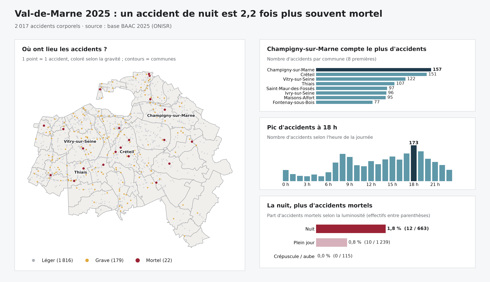

Partie 1 – Lisibilité des visualisations (règles 7 à 16)

Règle 7 – Étiquettes et graduations lisibles : Des graduations trop nombreuses, des textes trop petits ou des étiquettes qui se chevauchent rendent un graphique difficile à lire. Pour corriger cela, il faut limiter les graduations, adapter la taille de la police et raccourcir les intitulés. Dans mes graphiques, j'utilise une police de 12 à 13 points et une graduation toutes les trois heures sur l'axe horaire.

Règle 8 – Accessibilité des couleurs : Des couleurs trop nombreuses ou trop similaires peuvent rendre les données difficiles à distinguer, notamment pour les personnes daltoniennes. Il est préférable d'utiliser des couleurs contrastées et des palettes adaptées, sans faire reposer toute l'information sur la couleur. Dans mes graphiques, j'utilise le bleu et l'orange pour différencier les catégories et la palette Magma pour représenter les densités.

Règle 9 – Étiquetage direct : Une légende séparée oblige le lecteur à faire des allers-retours entre les courbes et les informations qu'elles représentent. Pour faciliter la lecture, il est préférable d'indiquer directement le nom des séries à proximité des courbes. Dans mes graphiques, j'indique les noms « Semaine » et « Week-end » près des courbes correspondantes et les codes des départements sur ma carte.

Règle 10 – Éviter les éléments décoratifs inutiles (Chartjunk) : Les effets 3D, les ombres et les quadrillages trop nombreux surchargent les graphiques sans apporter d'informations supplémentaires. Il faut donc privilégier une présentation simple et supprimer les éléments inutiles. Dans mes graphiques, j'utilise un thème minimaliste et je supprime les grilles secondaires ainsi que les axes qui font doublon avec les valeurs affichées.

Règle 11 – Limiter le nombre de catégories : Un trop grand nombre de catégories rend les graphiques difficiles à lire et complique les comparaisons. Pour éviter cela, il est possible de regrouper les petites catégories dans « Autres », de filtrer les données ou de répartir les informations dans plusieurs graphiques. Dans mes graphiques, je limite la représentation à huit départements au lieu de 101 et je regroupe les modalités de luminosité en cinq catégories.

Règle 12 – Trier les barres catégorielles : Des barres classées par ordre alphabétique ou aléatoire rendent les comparaisons moins évidentes. Il est préférable de les trier par valeur, du plus élevé au plus faible ou inversement, sauf lorsque les catégories suivent un ordre naturel. Dans mes graphiques, je classe les taux d'accidents graves du plus élevé au plus faible afin de repérer rapidement les valeurs importantes.

Règle 13 – Éviter la superposition des points dans les nuages de points : Lorsque de nombreux points sont représentés, ils peuvent se chevaucher et masquer certaines informations. Pour résoudre ce problème, on peut utiliser la transparence (alpha), le décalage des points (jitter) ou des représentations par zones de densité. Dans mes graphiques, j'utilise geom_hex pour représenter les accidents géolocalisés sous forme d'hexagones et mieux identifier les zones de concentration.

Règle 14 – Limiter le nombre de décimales : Un trop grand nombre de décimales alourdit la lecture et apporte parfois une précision inutile. Il est conseillé d'adapter le nombre de décimales aux données, en privilégiant généralement une ou deux décimales maximum. Dans mes graphiques, j'affiche les pourcentages sans décimale et les moyennes journalières avec une seule décimale, en respectant le format français.

Règle 15 – Bien formater les dates : Des dates trop longues ou trop nombreuses peuvent se chevaucher sur les axes et rendre le graphique difficile à lire. Il faut réduire le nombre de graduations et utiliser des formats plus courts, comme le nom du mois ou du trimestre. Dans mes graphiques, je simplifie les horaires avec des indications comme « 0h, 3h, 6h » plutôt que « 00:00 ».

Règle 16 – Privilégier l'économie visuelle : Un graphique contenant trop de courbes, d'annotations ou d'informations peut perdre son objectif principal. Il est préférable de simplifier la représentation et de consacrer chaque graphique à un message précis. Dans mes graphiques, je répartis les informations dans trois représentations distinctes : la localisation des accidents, leurs horaires et leur gravité. Cela facilite la lecture et la compréhension des résultats.

Partie 2 – Cartographie des accidents routiers dans le Val-de-Marne (2025)

Présentation et analyse

Pour cette partie, j'ai choisi d'étudier les accidents corporels de la circulation dans le Val-de-Marne en 2025, à partir de la base officielle BAAC de l'ONISR.
L'analyse porte sur 2 017 accidents. Le dashboard ci-dessus regroupe une carte et trois graphiques complémentaires.

La carte permet de visualiser la localisation des accidents dans le département. Les points sont colorés selon leur gravité : gris pour les accidents légers, orange pour les accidents graves et rouge pour les accidents mortels.

Le graphique par commune montre que Champigny-sur-Marne arrive en tête avec 157 accidents, suivie de Créteil (151) et de Vitry-sur-Seine (122).

La répartition horaire fait apparaître un pic à 18 h, avec 173 accidents recensés.

Enfin, la comparaison selon la luminosité montre que la part des accidents mortels est de 1,8 % la nuit, contre 0,8 % en plein jour. Elle est donc environ 2,2 fois plus élevée la nuit. Ces résultats représentent des proportions parmi les accidents recensés et non un risque rapporté au trafic.

Règles de lisibilité appliquées

Règle 7 – Étiquettes et graduations lisibles : Les noms des communes, les horaires et les valeurs sont affichés clairement.
Règle 8 – Utilisation des couleurs : Des couleurs distinctes permettent de différencier les niveaux de gravité.
Règle 9 – Étiquetage direct : Les valeurs sont indiquées directement sur les barres pour faciliter les comparaisons.
Règle 10 – Limitation du chartjunk :Les éléments décoratifs inutiles sont supprimés pour privilégier les informations.
Règle 12 – Tri des barres : Les communes sont classées de la plus touchée à la moins touchée.
Règle 13 – Gestion des points :Les points de la carte sont transparents pour limiter les superpositions et les accidents mortels sont mis en évidence.
Règle 14 – Titres informatifs :Les titres annoncent les principaux résultats afin de faciliter la compréhension du dashboard.

Conclusion
Cette visualisation met en évidence les différences de répartition des accidents selon les communes, les horaires et la luminosité. Elle montre notamment un pic à 18 h et une proportion d'accidents mortels plus importante la nuit.
